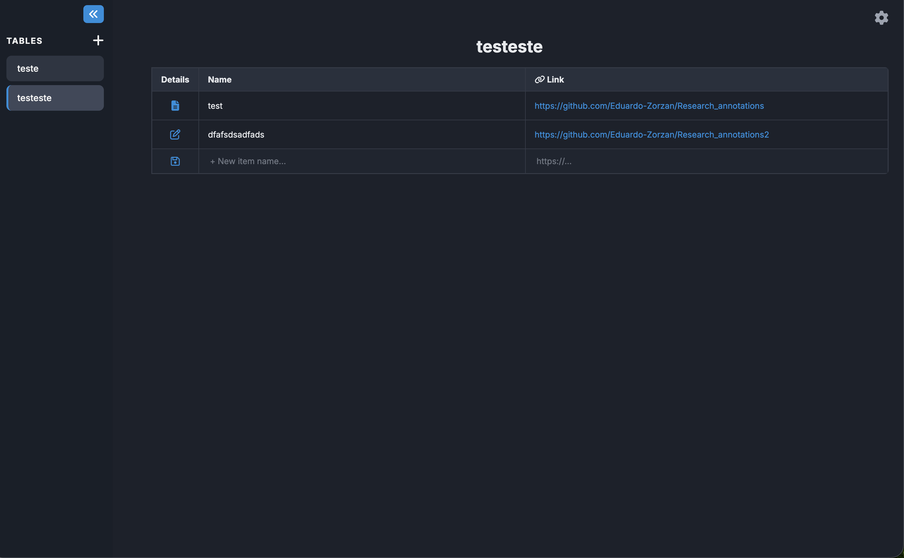
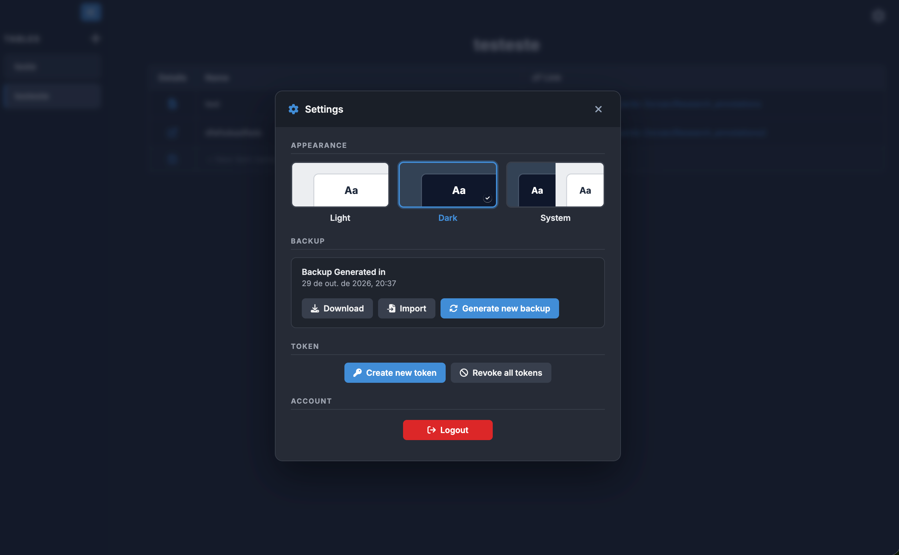
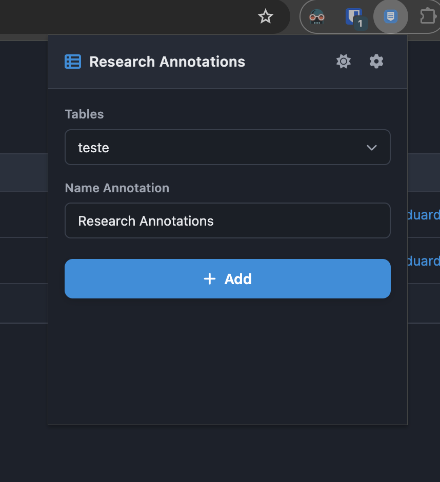

# Research Annotations

Research Annotations is a self-hosted web application for organizing research material. You create tables (for example, one per topic or project), and each table holds rows with a name, a link, and a rich-text note. A companion Chrome extension lets you save the page you are currently reading into one of your tables with a single click.

The server is written in Rust and stores everything in a local SQLite file, so it runs on a laptop, a small server, or even an Android phone through Termux.



## Features

- **Tables and rows**: create, rename, delete, and reorder tables by drag and drop. Each row has a Name, a Link, and a Details note, and rows can also be reordered and edited inline.
- **Rich-text notes**: each row opens a note editor (based on Editor.js) with headings, lists, checklists, code blocks, tables, and images. Type `/` to open the block menu. Notes support undo/redo and warn you before discarding unsaved changes.
- **Image uploads**: images added to notes are compressed in the browser and stored on the server, visible only to their owner.
- **Chrome extension**: saves the current tab's title and URL as a new row in any table, and warns you if a row with the same name already exists.
- **Live updates**: rows added through the extension appear in the open web page automatically, without a reload.
- **Backups**: the server creates a backup of every user's data once an hour. From the settings you can also generate a backup manually, download it as JSON, or import a previous one.
- **Themes**: light, dark, or follow the operating system.
- **Multiple users**: each user only sees their own tables, rows, and images.

## Requirements

- [Rust](https://www.rust-lang.org/tools/install) (stable, with support for the 2024 edition), or Docker.
- Node.js and npm, only if you change the TypeScript frontend. The compiled JavaScript in `public/js/` is already part of the repository.

## Configuration

The server reads its keys from a `.env` file in the project root:

```
TOKEN_KEY=<64 hex characters>
LOGIN_KEY=<64 hex characters>
```

- `TOKEN_KEY` (required) encrypts login tokens, extension tokens, and the IDs returned by the API. Once you start using the application, do not change it: doing so invalidates every session, every extension token, and every stored ID.
- `LOGIN_KEY` (optional) is only needed for older installations where passwords were stored with AES encryption. New passwords are hashed with Argon2, and old ones are converted automatically the next time each user logs in. Keep this key until every user has logged in at least once.

Each key must be 32 bytes written as 64 hexadecimal characters. You can generate one with:

```bash
openssl rand -hex 32
```

## Running locally

1. Create the `.env` file as described above.
2. Start the server:

   ```bash
   cargo run
   ```

   The server listens on `http://0.0.0.0:3000`, so it is reachable at `http://localhost:3000` and from other devices on the same network at `http://<your-ip>:3000`. The database file `my_database.db` and its tables are created automatically on the first run.

3. Create a user (there is no sign-up page):

   ```bash
   cargo run --bin new_users -- <username> <password>
   ```

   If you run it without arguments, it asks for the username and password interactively.

4. Open `http://localhost:3000` and log in.

For a faster, optimized build, use `cargo build --release` and run `target/release/Project_tables`.

## Running with Docker

1. Create the `.env` file.
2. Create the database file and data folders before the first start, so Docker mounts them as files and folders instead of creating empty directories:

   ```bash
   touch my_database.db && mkdir -p uploads backups
   ```

3. Build and start the container:

   ```bash
   docker compose up --build -d
   ```

4. Create a user inside the container:

   ```bash
   docker compose exec app /app/new_users <username> <password>
   ```

To stop the container, run `docker compose down`. The database, uploaded images, and backups stay on the host in `my_database.db`, `uploads/`, and `backups/`.

## Running on Android (Termux)

The server can run on an Android phone with [Termux](https://termux.dev) (install it from F-Droid or GitHub, not from the Play Store).

```bash
pkg update && pkg install -y git rust clang binutils
```

Phones with little memory may kill the compiler if it uses several threads, so build with a single job:

```bash
CARGO_BUILD_JOBS=1 cargo build --release
```

Run `termux-wake-lock` and disable battery optimization for Termux in the Android settings, so the system does not pause the build or the server.

## Using the application

### Tables and rows

- Use the sidebar to create a table, rename it inline, delete it, or drag it to a new position. The sidebar can be collapsed and resized.
- Selecting a table shows its rows. Add a new row from the empty line at the bottom, edit Name and Link by clicking on them, and drag rows to reorder them.
- The three-dots button on a row opens its options, such as deleting it.

### Notes

Click the Details cell of a row to open its note. Type `/` to insert a block (heading, list, checklist, code, table, image, and others). The editor can be resized or maximized.

- `Cmd+S` / `Ctrl+S` saves the note.
- `Cmd+Z` / `Ctrl+Z` undoes, and `Cmd+Shift+Z` / `Ctrl+Y` redoes.
- `Esc` closes the note. If there are unsaved changes, you are asked whether to keep editing or discard them.

### Settings

The gear button in the top right corner opens the settings:

- **Appearance**: choose Light, Dark, or System.
- **Backup**: see when the last backup was made, generate a new one, download it, or import a backup file. Importing replaces the current tables and rows of your account.
- **Tokens**: create a token for the Chrome extension (valid for one year), or revoke all tokens. Revoking also logs out every open web session.
- **Account**: log out.



## Chrome extension

The extension lives in the `extension/` folder.

### Installation

1. Open `chrome://extensions` in Chrome.
2. Turn on **Developer mode** in the top right corner.
3. Click **Load unpacked** and select the `extension/` folder of this project.

### Setup

1. In the web application, open Settings, go to **Tokens**, click **Create new token**, and copy it.
2. Click the extension icon in Chrome, then the gear icon in its popup.
3. Enter the application URL (for example `http://localhost:3000`) and paste the token.
4. Click **Load**. The extension checks the connection and loads your tables.

### Saving a page

1. Open the page you want to save.
2. Click the extension icon and choose a table.
3. The name field is filled with the page title. Edit it if you want. If a row with the same name already exists in that table, an "Already registered" warning appears, but you can still add it.
4. Click **Add**. The page URL is saved in the Link column.



## Development

The backend is in `src/` and the frontend source is in `frontend/src/` (TypeScript). After changing a `.ts` file, compile it into `public/js/`:

```bash
npm install
npx tsc
```

Then restart the server with `cargo run`. HTML, CSS, and JavaScript files from `public/` are embedded into the server binary at build time, so a rebuild is needed for frontend changes to show up.

### Project structure

```
src/
  main.rs            Server entry point, routes, CORS, hourly backup task
  bin/new_users.rs   Command-line tool to create users
  database/          Table creation and schema migrations
  handlers/          HTTP handlers (login, tables, rows, backups, tokens, uploads, static files)
  helpers/           Encryption, password hashing, tokens, access checks, route names
frontend/src/        TypeScript source for the web pages
public/              HTML, CSS, and compiled JavaScript served by the server
extension/           Chrome extension (Manifest V3)
Dockerfile           Multi-stage build for the frontend and the Rust server
docker-compose.yml   Runs the container with the database, uploads, and backups mounted
```
